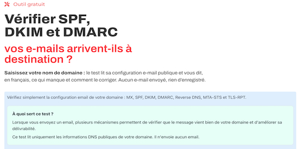

# 

## Auteur

👤 **Thierry LAVAL** — [Contact](mailto:contact@thierrylaval.dev)

* Github : [@Thierry Laval](https://github.com/thierry-laval)
* LinkedIn : [Thierry Laval](https://www.linkedin.com/in/thierry-laval)
* Site Web : https://thierrylaval.dev

---

## 📎 Projet

Outil de Vérification E-mail & DNS — Intégration Widget Elementor WordPress

_`Début du projet le 30/09/2025`_ — Version du script : 2.0.0 (25/09/2026)



---

<details open="open">
  <summary><h2>Table des matières</h2></summary>
  <ol>
    <li><a href="#à-propos-du-projet">À propos du projet</a>
      <ul>
        <li><a href="#construit-avec">Construit avec</a></li>
      </ul>
    </li>
    <li><a href="#architecture-des-fichiers">Architecture des fichiers</a></li>
    <li><a href="#commencer-à-travailler">Commencer à travailler</a>
      <ul>
        <li><a href="#conditions-préalables">Conditions préalables</a></li>
        <li><a href="#installation">Installation</a></li>
        <li><a href="#configuration-du-widget-elementor">Configuration du widget Elementor</a></li>
      </ul>
    </li>
    <li><a href="#fonctionnalités-détaillées">Fonctionnalités détaillées</a>
      <ul>
        <li><a href="#mx-reverse-dns-et-cname-racine">MX, Reverse DNS et CNAME racine</a></li>
        <li><a href="#spf">SPF</a></li>
        <li><a href="#dkim">DKIM</a></li>
        <li><a href="#dmarc">DMARC</a></li>
        <li><a href="#listes-noires-anti-spam-rbl">Listes Noires Anti-Spam (RBL)</a></li>
        <li><a href="#dnssec">DNSSEC</a></li>
        <li><a href="#bimi">BIMI</a></li>
        <li><a href="#dane--tlsa">DANE / TLSA</a></li>
        <li><a href="#mta-sts--tls-rpt">MTA-STS & TLS-RPT</a></li>
      </ul>
    </li>
    <li><a href="#nouvelles-fonctionnalités">Nouvelles fonctionnalités</a></li>
    <li><a href="#utilisation">Utilisation</a></li>
    <li><a href="#score-de-sécurité">Score de sécurité</a></li>
    <li><a href="#sécurité-intégrée">Sécurité intégrée</a></li>
    <li><a href="#compatibilité">Compatibilité</a></li>
    <li><a href="#structure-du-json-retourné">Structure du JSON retourné</a></li>
    <li><a href="#glossaire-technique">Glossaire technique</a></li>
    <li><a href="#limites-connues">Limites connues</a></li>
    <li><a href="#feuille-de-route">Feuille de route</a></li>
    <li><a href="#contribution">Contribution</a></li>
    <li><a href="#licence">Licence</a></li>
    <li><a href="#soutien">Soutien</a></li>
  </ol>
</details>

---

## À propos du projet

Cet outil analyse en profondeur la configuration e-mail publique, la réputation et la sécurité DNS d'un nom de domaine **sans envoyer le moindre e-mail** et **sans stocker aucune donnée**. Il produit un rapport complet et pédagogique, accessible aussi bien aux débutants qu'aux professionnels.

Cette version est spécialement optimisée pour une intégration transparente dans **WordPress via un widget Elementor HTML**, communiquant avec un endpoint backend PHP dédié et sécurisé.

Une mauvaise configuration e-mail peut entraîner :

* 📭 Des e-mails légitimes qui arrivent directement en boîte spam
* 🏴‍☠️ Des pirates qui envoient des faux e-mails en usurpant votre identité
* ❌ Des e-mails rejetés par les serveurs de réception (Gmail, Outlook, Yahoo)
* 📉 L'inscription de vos adresses IP sur des listes noires mondiales de spammeurs

### Construit avec

| Technologie | Rôle |
| :-----------: | :----: |
| PHP 7.4+ / 8.x | Backend API JSON REST ultra-rapide (`dns-checker.php`) |
| HTML5 / CSS3 / JavaScript Vanilla | Widget Elementor responsive & interactif (`bloc html.html`) |
| DNS natif PHP | Interrogations DNS directes (aucun abonnement ni clé API requis) |
| DNS-over-HTTPS (DoH) | Détection des enregistrements DS (DNSSEC) et TLSA (DANE) |
| cURL | Vérification HTTPS de MTA-STS et requêtes DoH |

---

<!-- ARCHITECTURE -->
## Architecture des fichiers

```
P54-audit-email-spf-dkim-dmarc-elementor/
│
├── dns-checker.php    ← Backend PHP (API REST ultra-rapide)
├── bloc html.html     ← Widget Elementor (HTML + CSS + JS)
├── img/               ← Captures d'écran et illustrations
├── LICENSE            ← Licence Academic Free License (AFL-3.0)
└── README.md          ← Ce fichier
```

### `dns-checker.php`
Le fichier PHP est le **moteur de l'outil**. Il :
- Reçoit les requêtes HTTP POST depuis le widget
- Interroge les DNS natifs (MX, SPF, DKIM, DMARC, PTR, RBL)
- Effectue les vérifications de sécurité avancée (DNSSEC, DANE, MTA-STS)
- Retourne un JSON structuré avec le statut et les scores

Il doit être **déposé sur votre serveur web**, par exemple dans :
```
/wp-content/tools/dns-checker.php
```

### `bloc html.html`
Le widget Elementor contient **l'interface utilisateur** :
- Formulaire de saisie du domaine et du sélecteur DKIM
- Styles CSS responsive et export PDF vectoriel dédié
- Moteur JavaScript d'affichage dynamique avec explications débutant et détails techniques

---

<!-- COMMENCER A TRAVAILLER -->
## Commencer à travailler

### Conditions préalables

* Hébergement web avec **PHP 7.4 ou supérieur**
* Extension PHP **`curl`** (ou `file_get_contents` en secours)
* Extension PHP **`dns_get_record`** (standard sur tous les hébergeurs)
* WordPress avec Elementor (version gratuite ou Pro)

### Installation

1. **Déposer `dns-checker.php`** sur votre hébergement via FTP / SFTP ou gestionnaire de fichiers :

   ```
   /wp-content/tools/dns-checker.php
   ```

2. **Vérifier l'accessibilité** — en accédant directement à l'URL dans votre navigateur, vous devez voir une réponse JSON `405` (car la méthode GET est rejetée par sécurité) :

   ```
   https://votre-site.com/wp-content/tools/dns-checker.php
   ```

3. **Créer une page WordPress** et ajouter un widget **HTML Elementor**.

4. **Coller l'intégralité** du code contenu dans `bloc html.html` dans le champ « Code HTML » du widget.

5. **Vérifier l'endpoint** dans le script JS du bloc (ligne définissant la constante) :

   ```javascript
   const ENDPOINT = '/wp-content/tools/dns-checker.php';
   ```

6. **Publier la page** ✅

### Configuration du widget Elementor

1. Dans l'éditeur Elementor, cliquez sur **« + »** pour ajouter une nouvelle section.
2. Recherchez le widget **« HTML »** dans la barre latérale.
3. Glissez-déposez le widget et collez-y le contenu de `bloc html.html`.
4. Cliquez sur **Mettre à jour** ou **Publier**.

**Réglages recommandés pour la mise en page :**
* **Largeur de la section** : Pleine largeur ou largeur contenu (jusqu'à 1000 px).
* **Padding** : 40 px en haut et en bas.
* **Fond** : Blanc ou très légèrement grisé (`#f8fafc`).

---

<!-- FONCTIONNALITÉS -->
## Fonctionnalités détaillées

| Contrôle | Niveau | Rôle et vérification |
|:---|:---:|:---|
| **MX & Reverse DNS** | 🔴 Indispensable | Serveurs de réception, PTR, FCrDNS croisé, détection CNAME racine, détection fournisseur (17 services) |
| **SPF** | 🔴 Indispensable | Enregistrement unique, récursion RFC 7208, limite 10 lookups, `+all` dangereux, arbre des `include:` |
| **DKIM** | 🔴 Indispensable | 18 sélecteurs testés automatiquement, taille de clé RSA (1024 bits dépréciée), détection révocation |
| **DMARC** | 🔴 Indispensable | Tags `v p sp pct adkim aspf rua ruf`, héritage sous-domaines, rapports externes RFC 7489 |
| **Listes Noires (RBL)** | 🔴 Indispensable | Réputation anti-spam des IPs des serveurs MX (Spamcop, Barracuda, PSBL, UCEPROTECT) |
| **DNSSEC** | 🟡 Sécurité DNS | Signature cryptographique de la zone DNS contre l'empoisonnement de cache (Cache Poisoning) |
| **BIMI** | 🟡 Optionnel / Marque | Logo SVG officiel, certificat VMC, compatibilité stricte DMARC requise |
| **DANE / TLSA** | 🟡 Optionnel / Avancé | Authentification DNS du certificat SSL/TLS des serveurs de messagerie (port 25) |
| **MTA-STS** | 🟡 Optionnel / Avancé | DNS TXT + vérification HTTPS du fichier `mta-sts.txt`, mode, max_age, liste MX autorisés |
| **TLS-RPT** | 🟡 Optionnel / Avancé | Enregistrement DNS, paramètre de réception des rapports d'échec `rua=` |

---

<a id="mx-reverse-dns-et-cname-racine"></a>
### 🔴 MX, Reverse DNS et CNAME racine

**Ce que ça vérifie :**
* La présence d'enregistrements MX dans le DNS du domaine.
* **Contrôle RFC 1034 sur la racine (@)** : alerte immédiate si un enregistrement CNAME a été configuré sur le domaine principal (ce qui neutralise tous les enregistrements MX et SPF).
* L'adresse IP (IPv4 et IPv6) associée à chaque serveur MX.
* Le **PTR (Reverse DNS)** : vérifie si un nom d'hôte valide est associé à l'IP.
* Le **FCrDNS (Forward-Confirmed Reverse DNS)** : vérifie la réconciliation bidirectionnelle IP ↔ Nom.
* La **détection automatique de votre messagerie** parmi 17 fournisseurs répertoriés.

---

<a id="spf"></a>
### 🔴 SPF (Sender Policy Framework)

**Ce que ça vérifie :**
* Présence d'un enregistrement SPF **unique** sous forme de TXT.
* Détection des **SPF multiples** (erreur critique PermError selon la RFC 7208).
* **Comptage strict des requêtes DNS** (limite maximale de 10 lookups).
* **Analyse récursive des `include:`** avec détection des boucles infinies.
* Détection des directives dangereuses : `+all` (autorise tout le monde), `?all` (neutre sans protection), `ptr` (déconseillé).
* Affichage de l'**arborescence complète des inclusions**.

---

<a id="dkim"></a>
### 🔴 DKIM (DomainKeys Identified Mail)

**Ce que ça vérifie :**
* La présence d'un enregistrement DKIM à l'hôte `sélecteur._domainkey.domaine.com`.
* **Découverte automatique parmi 18 sélecteurs courants** si aucun sélecteur n'est spécifié :  
  `default`, `mail`, `email`, `dkim`, `selector1`, `selector2`, `google`, `k1`, `k2`, `s1`, `s2`, `smtp`, `mailjet`, `sparkpost`, `sendgrid`, `mg`, `mandrill`, `pm`.
* Analyse des tags : `v=DKIM1`, type de clé (`k=rsa`), clé publique Base64 (`p=`).
* **Taille de clé RSA** : avertissement si la clé est en 1024 bits (dépréciée), recommandation 2048+ bits.
* Détection de révocation de clé (`p=` vide).

---

<a id="dmarc"></a>
### 🔴 DMARC (Domain-based Message Authentication, Reporting & Conformance)

**Ce que ça vérifie :**
* Présence de `_dmarc.domaine.com` ou héritage depuis le domaine parent.
* Analyse complète des tags : `v`, `p`, `sp`, `pct`, `adkim`, `aspf`, `rua`, `ruf`.
* **Vérification de l'autorisation des rapports externes (RFC 7489)** : contrôle que les prestataires tiers autorisent bien la réception des rapports.

| Politique | Effet | Recommandation |
| :--- | :--- | :--- |
| `p=none` | Surveillance uniquement, aucun blocage | Démarrage recommandé |
| `p=quarantine` | Les faux e-mails vont dans les spams | Intermédiaire sécurisé |
| `p=reject` | Les faux e-mails sont bloqués et détruits | Protection maximale |

---

<a id="listes-noires-anti-spam-rbl"></a>
### 🔴 Listes Noires Anti-Spam (RBL / DNSBL)

**Ce que ça vérifie :**
* Interrogation par DNS inverse des adresses IPv4 de vos serveurs de messagerie (MX).
* Consultation instantanée des principales listes noires publiques :
  * **Spamcop** (`bl.spamcop.net`)
  * **Barracuda Reputation Network** (`b.barracudacentral.org`)
  * **SURRIEL PSBL** (`psbl.surriel.com`)
  * **UCEPROTECT Niveau 1** (`dnsbl-1.uceprotect.net`)
* Tableau détaillé des résultats pour chaque IP avec badge vert `✓ Propre` ou alerte rouge `❌ Listé`.

---

<a id="dnssec"></a>
### 🟡 DNSSEC (Domain Name System Security Extensions)

**Ce que ça vérifie :**
* Présence d'enregistrements **DS (Delegation Signer)** dans la zone parente du domaine.
* Garantit que les enregistrements DNS n'ont pas été falsifiés lors de leur acheminement sur Internet.
* Affiche les clés DS publiées.

---

<a id="bimi"></a>
### 🟡 BIMI (Brand Indicators for Message Identification)

**Ce que ça vérifie :**
* Présence de `default._bimi.domaine.com`.
* URL HTTPS du logo SVG au format Tiny P.S.
* Détection du certificat de marque vérifiée VMC (`a=`).
* **Vérification de compatibilité DMARC** (nécessite `p=quarantine` à 100% ou `p=reject`).
* **Prévisualisation du logo** directement dans la carte de résultat.

---

<a id="dane--tlsa"></a>
### 🟡 DANE / TLSA

**Ce que ça vérifie :**
* Présence d'enregistrements TLSA sur le port 25 (`_25._tcp.mx-host`).
* Permet aux serveurs distants de vérifier l'empreinte cryptographique exacte du certificat SSL du serveur de messagerie.

---

<a id="mta-sts--tls-rpt"></a>
### 🟡 MTA-STS & TLS-RPT

* **MTA-STS** : Vérifie l'enregistrement DNS `_mta-sts` et télécharge le fichier HTTPS `https://mta-sts.domaine.com/.well-known/mta-sts.txt` (analyse du mode `enforce`/`testing`, du `max_age` et de la concordance des MX).
* **TLS-RPT** : Vérifie l'enregistrement `_smtp._tls.domaine.com` et l'adresse de réception des rapports d'échec de chiffrement (`rua=`).

---

## Nouvelles fonctionnalités

* **Architecture séparée Widget / API** : parfaite intégration dans Elementor avec un backend PHP léger.
* **Export PDF isolé & propre** : un système d'impression vectoriel dédié qui extrait le rapport sans interférence de thème.
* **Support des paramètres d'URL** : pré-remplissage et analyse instantanée via liens directs (`?domain=...`).
* **Arborescence graphique du SPF** : visualisation pas à pas de chaque `include:` et du nombre exact de requêtes DNS consommées.

---

## Utilisation

### Lancement automatique via URL

Vous pouvez pré-remplir et lancer un audit en transmettant des paramètres d'URL :

```
https://votre-site.com/audit-email/?domain=exemple.fr
https://votre-site.com/audit-email/?domain=exemple.fr&selector=google
```

| Paramètre | Alias acceptés | Description |
| :--- | :--- | :--- |
| `domain` | `d`, `domaine` | Domaine à analyser |
| `selector` | `s` | Sélecteur DKIM (facultatif) |

### Export PDF isolé

Cliquez sur le bouton **🖨️ Imprimer / Exporter en PDF** situé à côté du score :
* **Document isolé 100% autonome** : aucun widget WordPress environnant n'est imprimé.
* **Mise en page A4 professionnelle** : typographie proportionnée, en-tête officiel avec date et domaine, saut de page intelligent évitant de couper les cartes.
* **Détails techniques complets** : tous les blocs de données sont automatiquement dépliés pour le PDF.

---

## Score de sécurité

Score global calculé sur **100 points** :

| Contrôle | Points max | Critères |
| :--- | :---: | :--- |
| **MX & Reverse DNS** | 20 pts | ok=20 · warning=10 · error=0 (pénalité si CNAME racine) |
| **SPF** | 20 pts | ok=20 · warning=10 · error=0 |
| **DKIM** | 20 pts | ok=20 · warning=10 · error=0 |
| **DMARC** | 20 pts | reject=20 · quarantine=16 · none=10 · warning=8 · error=0 |
| **Listes Noires (RBL)** | 10 pts | ok=10 (propre) · error=0 (listé) |
| **DNSSEC** | 5 pts | ok=5 (actif) |
| **Chiffrement garanti** | 5 pts | MTA-STS ou DANE ok = 5 |

> [!NOTE]
> BIMI et TLS-RPT sont informatifs et ne pénalisent pas le score de sécurité pure.

**Interprétation du score :**
* **90 – 100** : 🏆 Configuration exemplaire
* **75 – 89** : ✅ Bon niveau de sécurité
* **50 – 74** : ⚠️ Passable, des améliorations importantes sont recommandées
* **0 – 49** : ❌ Configuration critique ou vulnérable

---

## Sécurité intégrée

* **Méthode POST obligatoire** — empêche les appels directs GET et protège contre les scans non désirés.
* **Honeypot anti-bot** — champ invisible piège rejetant automatiquement les soumissions de robots.
* **Assainissement strict** — nettoyage et validation des noms de domaine et sélecteurs DKIM.
* **Zéro stockage** — aucune donnée personnelle enregistrée, aucun fichier log créé sur le serveur.
* **Zéro appel payant** — fonctionne exclusivement via résolutions DNS et DoH publiques gratuites.

---

## Compatibilité

| Composant | Version supportée |
| :--- | :--- |
| PHP | 7.4, 8.0, 8.1, 8.2, 8.3, 8.4, 8.5+ |
| Hébergements | o2switch, OVHcloud, cPanel, Cloudways, Infomaniak, VPS, etc. |
| WordPress | 5.0 à 6.x |
| Elementor | Gratuit ou Pro |
| Navigateurs | Chrome, Firefox, Safari, Edge, navigateurs mobiles |

---

## Structure du JSON retourné

Lors d'un appel AJAX vers `dns-checker.php`, le script retourne un objet JSON structuré :

```json
{
  "success": true,
  "domain": "thierrylaval.dev",
  "score": 85,
  "summary": "La configuration contient des éléments fonctionnels...",
  "counts": { "error": 0, "warning": 2, "ok": 6, "info": 2 },
  "results": {
    "mx": { "status": "ok", "provider": "...", "records": [...] },
    "spf": { "status": "ok", "record": "...", "dns_lookups": 2, "tree": [...] },
    "dkim": { "status": "ok", "selector": "default", "key_size": 2048, "record": "..." },
    "dmarc": { "status": "ok", "policy": "quarantine", "record": "..." },
    "rbl": { "status": "ok", "ips": [...] },
    "dnssec": { "status": "ok", "records": [...] },
    "bimi": { "status": "info", "svg_url": "..." },
    "dane": { "status": "warning", "records": [] },
    "mta_sts": { "status": "warning", "mode": "testing", "policy": {...} },
    "tls_rpt": { "status": "ok", "record": "..." }
  }
}
```

---

## Glossaire technique

| Terme | Définition |
| :--- | :--- |
| **DNS** | Domain Name System – l'annuaire universel d'Internet |
| **MX** | Mail eXchanger – enregistrements indiquant les serveurs de réception e-mail |
| **Zone Apex** | Le domaine racine (ex: `domaine.fr`), qui ne doit jamais comporter de CNAME |
| **PTR** | Pointer Record – résolution inverse permettant de retrouver un nom depuis une adresse IP |
| **FCrDNS** | Forward-Confirmed Reverse DNS – double validation croisée IP ↔ Nom d'hôte |
| **RBL / DNSBL** | Real-time Blackhole List – liste noire surveillant les IPs émettrices de spam |
| **SPF** | Sender Policy Framework – liste des serveurs autorisés à envoyer des e-mails |
| **DKIM** | DomainKeys Identified Mail – signature cryptographique certifiant l'expéditeur |
| **DMARC** | Norme suprême indiquant aux destinataires comment traiter les e-mails non authentifiés |
| **DNSSEC** | Signatures cryptographiques garantissant la non-falsification des enregistrements DNS |
| **BIMI** | Affichage du logo officiel de marque directement dans les boîtes de réception |
| **DANE / TLSA** | Authentification des certificats TLS des serveurs MX directement par le DNS |
| **MTA-STS** | Forçage du chiffrement TLS entre serveurs de messagerie |
| **TLS-RPT** | Rapports quotidiens sur la qualité des connexions sécurisées TLS |

---

## Limites connues

1. **Découverte DKIM** : Le DNS ne permet pas de lister les sélecteurs existants. L'outil teste 18 sélecteurs courants ; pour un sélecteur sur mesure, renseignez-le dans le champ dédié.
2. **Listes RBL** : Les RBL sont testées sur les serveurs MX de réception. Si vos e-mails sortants transitent par un relais SMTP distinct (ex: Brevo, SendGrid), surveillez également l'IP dédiée de ce relais.
3. **Propagation DNS** : Une modification de zone DNS peut nécessiter quelques minutes à plusieurs heures pour se propager (selon le TTL configuré).

---

## Feuille de route

- [x] MX + Reverse DNS (PTR) + FCrDNS
- [x] Contrôle d'anomalie CNAME sur la racine (RFC 1034)
- [x] Détection automatique du fournisseur de messagerie (17 services)
- [x] SPF récursif RFC 7208 avec arbre des inclusions
- [x] DKIM (18 sélecteurs + estimation de taille de clé RSA)
- [x] DMARC complet + vérification des rapports externes RFC 7489
- [x] Vérification des listes noires anti-spam (RBL)
- [x] Détection de l'activation DNSSEC (enregistrements DS)
- [x] BIMI avec aperçu du logo SVG et vérification VMC
- [x] DANE / TLSA (port 25)
- [x] MTA-STS (DNS + validation du fichier HTTPS)
- [x] TLS-RPT
- [x] Lancement automatique via paramètres d'URL (`?domain=`)
- [x] Export PDF autonome et isolé (sans interférence de thème)
- [ ] Historique des derniers audits (localStorage)

---

### Utilisé dans ce projet

| Langages & Outils | Applications |
| :---: | :---: |
| PHP 7.4 / 8.x | Visual Studio Code |
| JavaScript Vanilla | WordPress + Elementor |
| CSS3 (responsive + print) | Git / GitHub |

#### Merci à tous

---

## Contribution

_**N'hésitez pas à contribuer, en ouvrant une issue.**_

* Fork → nouvelle branche → commit → pull request.  
* Respectez les bonnes pratiques, tests et sécurité (ne pas committer les credentials).

---

<a id="licence"></a>

## 📝 Licence

[Licence libre académique 3.0 (AFL-3.0)](https://github.com/thierry-laval/P54-audit-email-spf-dkim-dmarc-elementor/blob/main/LICENSE)

### Avis d'attribution

**Outil de Vérification E-mail & Sécurité DNS — Module Elementor** a été créé par **Thierry Laval** : [thierrylaval.dev](https://thierrylaval.dev/).  
Projet original : [github.com/thierry-laval/P54-audit-email-spf-dkim-dmarc-elementor](https://github.com/thierry-laval/P54-audit-email-spf-dkim-dmarc-elementor).  

Toute œuvre dérivée doit conserver cette mention, le nom de l'auteur et les liens ci-dessus.

Copyright © 2026 Thierry Laval — https://thierrylaval.dev

---

<a id="soutien"></a>

## 💙 Soutien

Si vous appréciez ce projet, vous pouvez me soutenir :

<a href="https://paypal.me/thierrylaval01?country.x=FR&locale.x=fr_FR" target="_blank"></a>

[Voir mon travail](https://github.com/thierry-laval)

---

### ♥ Love Markdown

Donnez une ⭐️ &nbsp;si ce projet vous plaît !

### 🐙 FAN DE GITHUB


**[⬆ Retour en haut](#auteur)**

